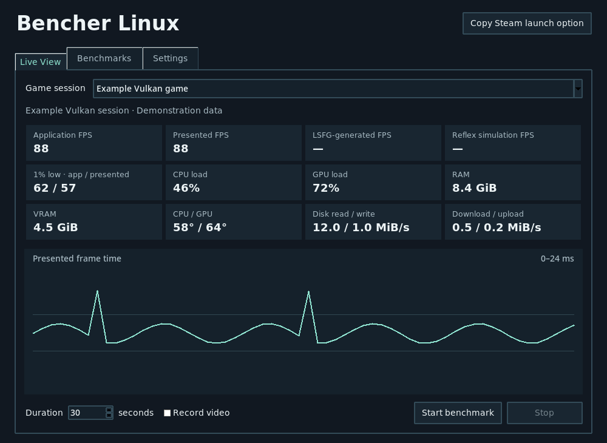

# Bencher Linux

Record and inspect Linux gameplay performance locally. Bencher has a customizable desktop Live View, timed benchmarks, a saved report library, configurable graph filters, CSV exports, and synchronized video when Gamescope provides a capture source.



## Install

Dependencies depend on your desired capture path. Python 3.11 or later and Tk provide the desktop. A C/C++ compiler and Vulkan headers build the native frame probes. MangoHud offers a fallback capture.

| Distribution | Desktop and native probes |
| --- | --- |
| Arch / CachyOS | `sudo pacman -S python tk python-pip base-devel vulkan-headers` |
| Ubuntu / Debian | `sudo apt install python3 python3-venv python3-tk build-essential libvulkan-dev` |
| Fedora | `sudo dnf install python3 python3-tkinter gcc gcc-c++ vulkan-headers` |

```sh
git clone https://github.com/zotvn/Bencher-linux.git
cd Bencher-linux
./install.sh
```

The installer adds a per-user desktop launcher and two commands in `~/.local/bin`: `bencher` and `bencher-linux`. Run `bencher doctor` to inspect capture support. You can also run `pipx install --system-site-packages .` and `bencher build-probe`.

## Record a benchmark

1. Open Bencher Linux. Use **Copy Steam launch option** and paste it into the game's Steam launch options. The button includes the installed Python path so Steam can find it.
2. Launch the game. It will appear in **Live View**. Choose a duration and select **Start benchmark**. Return to the game during the countdown. Benchmark averages and 1% lows use frames inside that run.
3. Open **Benchmarks** and select the report. Click a metric to plot it. Use threshold filters or the slowest 1% filter to jump to moments on the timeline. When video is available, drag to preview each recorded frame and release to view it at full quality.

For native games or another launcher, wrap the existing executable or launcher command.

```sh
bencher run -- /path/to/game
bencher run --target Game.exe -- /path/to/launcher
bencher sessions
bencher record --seconds 120 --delay 5
```

The target is the final executable basename (case-insensitive). Bencher automatically detects common `.exe` targets in Proton commands. Launchers with unusual process names may need `--target`. For native Steam under a shell Steam may require the absolute command generated by the desktop app. Flatpak Steam requires the probe library and data paths inside its sandbox and is outside the initial tested matrix.

## Frame generation

Choose **Settings → Frame generation** before launching a game.

| Setting | Capture behavior |
| --- | --- |
| LSFG-VK off · In-game mode unknown | Application frame timings, plus Gamescope presentation data when available |
| Frame generation disabled in game | Treats the application frames as real. Also turn off generation in the game. |
| Enable LSFG-VK | Enables your installed LSFG-VK layer and optional profile. The Vulkan probe counts accepted game and generated submissions when the layer is observed. Turn off the game's built-in generation when using LSFG-VK. |
| In-game frame generation enabled | Disables LSFG-VK for the launch. The game's DLSS or FSR controls still work. Reports show application output, Gamescope events when available, and Reflex simulation cadence when the game emits markers. |

Bencher never edits the game's graphics settings or the user's LSFG-VK configuration. A generic Vulkan/GL capture cannot reliably separate real and generated frames in arbitrary built-in implementations. Reflex simulation FPS measures simulation markers. A physical display capture can differ from both application and Gamescope counters. [LSFG-VK environment variables](https://lsfg-vk.dev/docs/configuration/environment-variables/) · [Vulkan Reflex markers](https://docs.vulkan.org/refpages/latest/refpages/source/VkLatencyMarkerNV.html)

## Capture support

- **Vulkan and Vulkan-based Proton rendering** use the native 64-bit Vulkan layer with an up-to-date Vulkan loader. The OpenGL fallback probe observes typical GLX and EGL swaps on 64-bit native Linux. Some wrappers and anti-cheat configurations reject injected layers or preload libraries.
- **MangoHud** is optional. Select it in Settings for its sampled log capture if native injection is unavailable. CSVs can flush in batches, so exact frame timestamps may be absent. [MangoHud configuration](https://github.com/flightlessmango/MangoHud/blob/master/data/MangoHud.conf)
- **Nested Gamescope** supplies presentation timing where the app timing protocol and XWayland window identification are available. `bencher run --gamescope -- GAME` starts a nested session. A capture started directly on the desktop can still show application timings.
- **Video** requires nested Gamescope with a PipeWire video node, PyGObject, GStreamer with H.264 encoder and MP4 plugins, and FFmpeg. NVENC is used when its GStreamer element is available. The software option encodes at up to 720p/60 FPS. The timeline uses the closest recorded frame. Hardware readings use their own sampling cadence. [Gamescope](https://github.com/ValveSoftware/gamescope)
- **Sensors** use Linux procfs/sysfs and NVIDIA SMI where installed. AMD busy and VRAM counters use DRM sysfs when exposed. Intel and other driver counters may be unavailable. Hardware cards show a dash for unavailable values.
- **Live View settings** control visible metrics, refresh period, recording delay, default duration, default video and report folder. Keep Live View slim while playing. Reports can be named in the library and deleted through desktop Trash when `gio` is available.

## Data and development

Benchmarks are local HTML, JSON and CSV. Video runs add MP4 and preview sheets. Defaults follow XDG directories, with reports under `~/.local/share/bencher-linux/benchmarks`. For local warnings and capability checks use `bencher doctor`.

```sh
./scripts/check.sh
python -m bencher_linux gui
```

Bencher Linux is an independent MIT-licensed project. Vulkan headers, LSFG-VK, proprietary frame-generation components, and capture dependencies are installed separately.
